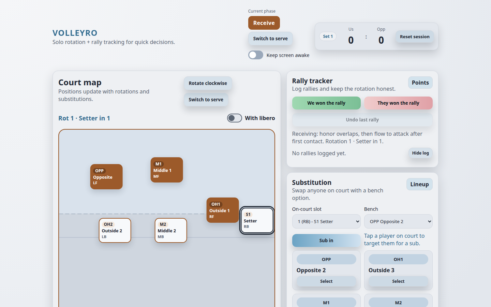
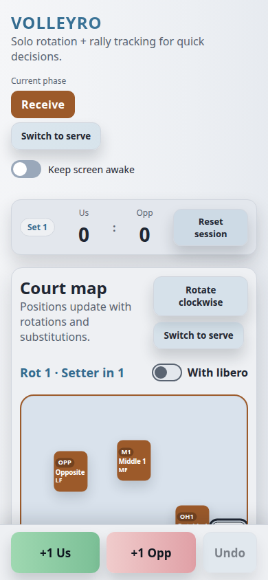

# VolleyRo

Learn how the volleyball **5-1 rotation** works, one rotation at a time. VolleyRo is a small, free web app for beginner players that shows where everyone stands on court in every rotation, in serve and in receive, and lets you track a match along the way.

[](https://github.com/Durianlychee/VolleyRo/actions/workflows/test.yml)
[](https://durianlychee.github.io/VolleyRo/)
[](LICENSE)

**[Open the live demo](https://durianlychee.github.io/VolleyRo/)** (works on a phone and offline after the first visit)

| Desktop | Phone |
| --- | --- |
|  |  |

## What it teaches

In a **5-1** system a team plays one setter and five hitters: two outside hitters, two middle blockers and an opposite. After every side-out (when the receiving team wins the rally and gains the serve) all six players rotate one position clockwise. That gives six **rotations**, and in each one the setter starts in a different spot (positions 1, 6, 5, 4, 3, 2 as you play Rotation 1 to 6).

VolleyRo shows the starting lineup for each rotation, the serve formation and the receive formation, and checks that every formation respects the **FIVB overlap rule** (7.4.3). The rules it follows are those of the FIVB (the international volleyball federation).

Match tracking (score, sets, log) is an extra that keeps the lesson tied to a real game.

## Features

- **Court map** for each of the six 5-1 rotations, in serve and in receive, with a label such as "Rot 2 · Setter in 6" that names the rotation by play order and by where the setter stands.
- **Conventional serve-receive**: the two outside hitters and the back-row middle pass, while the setter and the opposite stay out of the passing line. Every formation is legal under the FIVB overlap rule.
- **Role-name tokens** (Setter, Outside 1, Middle 1, Opposite, and so on) instead of real names, with front-row players filled and back-row players outlined.
- **Optional libero**: an off-by-default "With libero" switch. When on, an amber Libero token replaces the back-row middle, and under FIVB the libero never serves.
- **Substitutions** between on-court slots and bench players.
- **Rally tracker** with win/loss buttons, auto-rotation on a side-out, a collapsible log and **Undo** for the last rally.
- **FIVB set end**: a set is won at 25 points with a two-point lead (15 in the fifth set), then a prompt starts the next set.
- **Saves your match** in the browser and resumes it when you come back.
- **Works offline and installs to the home screen** (service worker and web app manifest).
- **Keep screen awake** switch (Screen Wake Lock API) so a phone does not dim mid-lesson.

## Run locally

There is no build step and nothing to install. Serve the folder with any static server and open it in a browser:

```sh
python3 -m http.server 8000
# then visit http://localhost:8000
```

Opening `index.html` directly also works, but the service worker (offline mode and install) needs `http://localhost` or HTTPS.

## Run the tests

You need Node 22 or newer. There are no dependencies to install:

```sh
node --test
```

The tests load the real `app.js` against a small fake DOM in `test/harness.js`. GitHub Actions runs the same command on every push and pull request.

## Project structure

```
index.html            page markup
styles.css            styles (colours are CSS variables in :root)
app.js                all app logic: rotations, formations, scoring, saving
sw.js                 service worker (offline cache)
manifest.webmanifest  home-screen install metadata
*.png, favicon.svg    icons
test/                 node --test suite and fake-DOM harness
docs/                 README screenshots
.github/              CI workflow and issue templates
```

The app files stay at the repository root because GitHub Pages serves the site from `main` at `/`. When you change a cached shell file, bump `CACHE_VERSION` in `sw.js`.

## Roadmap

Ideas, not promises:

- A selectable rulebook (other rule sets beyond FIVB).
- A roster editor, so you can set your own player labels.
- Match stats.

## Contributing

Issues and pull requests are welcome. See [CONTRIBUTING.md](CONTRIBUTING.md).

## Licence

Released under the [MIT License](LICENSE).
